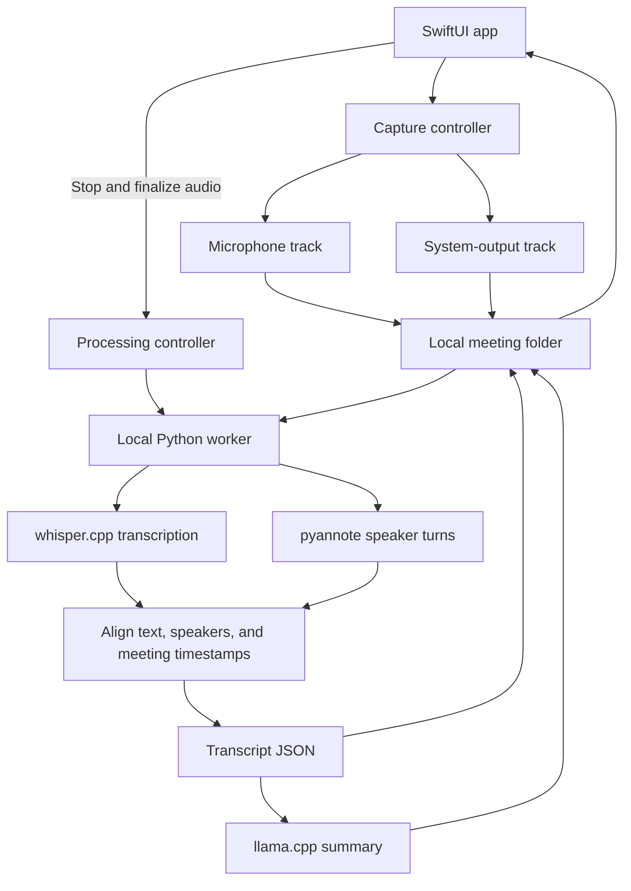

<!-- markdownlint-configure-file {"MD013": {"tables": false}} -->

# Afterword — High-Level Design

Date: 2026-09-30

Status: Agreed product scope and proposed implementation design; not implemented
or benchmarked. This document is the handoff for the implementation agent.

## 1. Product goal

Afterword is a local macOS app that records both sides of a meeting and turns
the recording into a speaker-labeled transcript and useful meeting notes.
The user normally wears headphones. All meeting audio and inference remain
on the Mac after initial dependency and model setup.

The primary flow is:

Record → Pause / Resume as needed → Stop → Process → Review.

“Keep recording” means continuous capture within an explicitly started session,
including silence. It does not mean recording automatically at login, detecting
meetings, or monitoring the microphone outside a session.

## 2. Scope

### Version 1

- Explicit Record, a single Pause / Resume toggle, and Stop.
- Separate microphone and system-output audio capture.
- Continuous recording to disk; no transcription during recording.
- Automatic local transcription, speaker labeling, and summary after Stop.
- Timestamped transcript with anonymous speaker labels and manual renaming.
- Summary containing discussion points, decisions, action items, and open
  questions, linked to supporting transcript segments.
- A local meeting list and a meeting detail view with processing status,
  transcript, summary, and access to saved files.
- Preservation of audio when processing fails, with an explicit retry action.

### Deferred

- Live captions and streaming inference.
- Persistent voice profiles and speaker matching across meetings.
- Reliable separation of simultaneous voices sharing one microphone.
- Meeting-platform integrations, participant roster extraction, and bots.
- Automatic meeting detection, background all-day recording, and calendars.
- Cloud inference, accounts, synchronization, and collaborative editing.
- Cross-platform support, App Store distribution, and an installer that bundles
  every runtime and model. A reproducible local setup is sufficient for v1.
- Advanced transcript editing, search, and custom summary templates.

Shared-microphone recordings can go through the v1 diarization pipeline, but
their quality is best effort. Dedicated improvements belong in a later version.

## 3. Technology choices

| Concern | Choice | Reason |
| --- | --- | --- |
| Desktop application | Swift + SwiftUI | Native controls and direct integration with macOS capture and permissions. |
| Minimum OS | macOS 15 | Baseline for the selected microphone and system-audio capture path. |
| Capture | ScreenCaptureKit | Separate microphone and system-audio sample streams. |
| Audio writing and conversion | AVFoundation | Incremental file writing and preparation of model input. |
| Speech recognition | whisper.cpp | Local inference with Apple Silicon acceleration. |
| Speaker diarization | pyannote Community-1 | Existing local pipeline for identifying speaker turns. |
| Processing coordination | Local Python worker launched by Swift | Integrates pyannote and invokes local model executables without a server. |
| Summarization | llama.cpp + a local instruction model | Local text inference; select weights after hardware and language validation. |
| Persistence | Per-meeting audio files and JSON | Sufficient for a personal app without a database service. |

Apple's [capture sample][apple-capture] demonstrates separate audio and
microphone outputs on macOS 15+. [whisper.cpp][whisper] supports local inference
and Apple Silicon acceleration. [Community-1][pyannote] supports offline use after
model setup. [llama.cpp][llama] supplies local language-model inference.

Swift owns capture and the UI. The Python worker owns post-recording processing.
Use child processes with argument arrays and a small structured progress
protocol; no HTTP server, Docker, Electron, or web frontend is needed.

The main tradeoff is Python/PyTorch packaging. This is acceptable for a personal
v1 because it avoids implementing or porting speaker diarization. Pin a tested
Python environment and executable versions during implementation. Do not depend
on whichever tools happen to appear first in the user's shell PATH.

## 4. Architecture



These are responsibilities, not separate services or mandatory packages:

- **Capture controller:** permissions, stream lifecycle, audio meters,
  timestamp mapping, pause boundaries, and incremental audio writes.
- **Meeting store:** meeting folders, atomic metadata updates, and discovery of
  completed or interrupted sessions at launch.
- **Processing controller:** launch and monitor one processing job, persist
  stage status, and expose retry after failure.
- **Worker:** prepare audio, run models, align results, and produce artifacts.
- **Views:** recording controls, meeting list, and meeting details.

Keep one active recording and one processing job at most. For the first release,
disable starting another meeting while processing. Concurrent recording and
processing are unnecessary for the initial workflow.

## 5. Recording behavior and states

| State | Available action | Result |
| --- | --- | --- |
| Idle | Record | Validate capture prerequisites and start a new meeting. |
| Recording | Pause | Stop accepting audio into the meeting and record a pause boundary. |
| Paused | Resume | Resume both sources in a new recording interval within the same meeting. |
| Recording or Paused | Stop | Finalize retained audio and automatically begin processing. |
| Finalizing or Processing | None for this session | Show the current stage and keep the UI responsive. |
| Ready | Review or rename speakers | Display saved transcript and summary. |
| Processing failed | Retry | Retry processing using retained audio or completed intermediate results. |
| Interrupted recording | Process saved audio | Finalize recoverable audio; do not silently restart recording. |

Pause applies to both sources. Paused audio must never be persisted or submitted
to a model. Disable capture delivery while paused where practical and gate
queued callbacks at the pause boundary. Show Paused only after the boundary is
established. Do not replay buffered pause audio on Resume.

Stop works while paused. It is handled once even if clicked repeatedly. Audio
writers must finish before a worker reads their files. A meeting stopped without
usable speech yields an explicit empty result, not invented text or a summary.

Show an obvious recording indicator, elapsed meeting time, captured duration,
and separate microphone/output meters. Silence is valid audio behavior; a zero
meter alone does not establish capture failure.

## 6. Capture, synchronization, and interruptions

### Source selection

Use ScreenCaptureKit for system output and microphone capture, with the required
macOS permissions. The v1 default is system-output capture, clearly labeled so
the user understands other application sounds may be included. Meeting-app-only
filtering is optional later scope, not a requirement for the first release.

Capture and persist audio only; no screenshots or video files are required.
Afterword must not play captured audio back during recording. Headphones reduce
remote-audio leakage into the microphone; v1 does not implement echo cancellation.

Separate participant devices do not give Afterword separate remote tracks.
Meeting audio generally arrives as one mix, so voice-based diarization is still
needed. Track origin and speaker identity are different concepts.

### Audio storage and timeline

Keep microphone and system output separate throughout capture and processing.
Write incrementally to disk rather than buffering an entire meeting in RAM.
Use bounded, independently finalized audio chunks, with additional boundaries
at Pause and Stop, to limit loss from an interrupted write.

Record each chunk's source, format, meeting-relative start offset, and duration.
Use media timestamps mapped onto a shared monotonic meeting timeline, not
callback arrival times. Record wall-clock start time for display separately.

The meeting timeline includes pauses. For example, 60 seconds recorded followed
by a 30-second pause means the next spoken segment starts around 01:30, not
01:00. Store pause intervals explicitly and render a marker in the transcript.
Do not store or infer the audio that occurred inside those intervals.

Prepare 16 kHz mono audio for models without losing source or timeline mappings.
Handle sample-rate conversion and unequal track start times explicitly.
When concatenating recorded intervals for processing, keep an offset map so
output timestamps can be translated back to the original meeting timeline.

### Failure handling

If a stream fails, a device disappears, a write fails, or the Mac sleeps,
transition to an interrupted state with a visible reason and preserve finalized
chunks. Do not silently claim both sources were captured. After recovery, offer
processing of retained audio; seamless capture recovery is later scope.

On relaunch, detect unfinished sessions and jobs. Never resume recording without
a user action. Preserve completed files and mark incomplete artifacts for
recovery or regeneration. Graceful application exit should finalize an active
recording; an unexpected termination must leave prior chunks usable.

## 7. Post-stop processing

Run stages sequentially initially to bound memory use. Release model resources
between stages where possible. Progress can name the active stage without
claiming an accurate percentage or completion time.

### Transcription

Run whisper.cpp on prepared audio for each source. Use speech detection to
reduce silence-related hallucinations and retain timestamps. Preserve the
spoken language; translation is outside v1 scope.

Select and pin the Whisper model after testing the user's meeting languages
and hardware. Do not silently truncate long recordings. If processing in
chunks, handle boundary words and deduplicate overlapping transcription windows.

### Speaker labeling

Run Community-1 on the system-output recording, then align speaker turns with
transcribed segments. Obtain speaker consistency across the whole source's
recorded audio rather than assigning unrelated speaker IDs to each file chunk.
The model supports offline inference and provides an exclusive diarization
output that helps timestamp alignment. Its documented default is CPU execution;
Mac GPU acceleration and throughput must be validated rather than assumed.
[Source: Community-1 model card][pyannote].

For the initial headphone workflow, label microphone speech as “You” and remote
voices as “Speaker 1,” “Speaker 2,” and so on. This assumes one local microphone
speaker. Multiple people using the local microphone are a documented v1
limitation; do not imply they have been individually identified.

Multiple remote people sharing one endpoint can be clustered by voice using the
same pipeline, with reduced reliability. Use “Unknown” when assignment is not
supported. Do not merge identities across microphone and output automatically.

Align using the finest reliable transcription timestamps available; split
segments at supported speaker boundaries. Preserve ambiguous or overlapping
turns rather than presenting guessed identity as certainty.

Manual renaming updates a meeting-local speaker-name map. Transcript segments
reference stable speaker IDs, not copied display names. No voice enrollment or
cross-meeting matching is performed in v1.

### Summarization

Pass the merged, timestamped transcript to a local instruction model through
llama.cpp. Produce structured notes containing:

- A concise overview and key discussion points.
- Decisions, with supporting transcript segment IDs.
- Action items, with owner and due date only when explicitly supported.
- Open questions and unresolved issues.

Keep unknown owners and dates unspecified. Treat transcript text as meeting
content, not instructions to the app. The summary process has no tool access.
Validate output structure and referenced segment IDs before marking it ready.
Correct references alone do not prove factual accuracy; human review remains
part of acceptance testing.

For transcripts exceeding the model context, summarize bounded sections and
combine their notes while retaining original references. Never silently drop
the end of a meeting. Speaker references in structured notes should use stable
IDs so manual renaming updates the display; any names embedded in generated
prose need regeneration or must be marked stale after a rename.

Save the transcript before starting summarization. A summary failure must leave
the transcript reviewable and allow a summary-only retry.

## 8. Local persistence and process boundary

Store application data under
`~/Library/Application Support/Afterword/`, separate from the source checkout.

```text
Afterword/
  models/
  meetings/
    <meeting-id>/
      meeting.json
      audio/
        <source>-<chunk-id>.caf
      transcript.json
      summary.json
      work/
```

CAF is the proposed capture container; verify interruption recovery with the
chosen encoding before committing to it. Prepared model inputs belong in
`work/`; original retained audio remains the source for retries.

Minimum logical data:

| Artifact | Contents |
| --- | --- |
| Meeting | Schema version, ID, title, start time, durations, recording status, processing stage/error, pause intervals, chunk manifest, speaker display-name map, runtime/model versions. |
| Audio chunk | Source, file path, sample format, sample count, meeting-relative offset, finalized status. |
| Transcript segment | Stable ID, source, start/end offsets, text, speaker ID or unknown, ambiguity indicator where available. |
| Summary | Overview, discussion points, decisions, action items, open questions, supporting segment references, transcript revision. |

Use atomic replacement for JSON files. Swift owns `meeting.json`; the worker
writes processing artifacts and reports progress so there are no competing
metadata writers. A stage is complete only after its artifact is finalized and
validated. Retrying must not duplicate meetings or transcript segments.

Launch the worker with a meeting path and explicit local model/runtime paths.
Use newline-delimited JSON progress events on stdout and bounded diagnostics
on stderr. Errors need a stage and useful explanation. Keep meeting content out
of routine logs. The Swift app observes process exit and checks expected
artifacts; exit code zero alone is insufficient proof of success.

No cloud services, remote API calls, or telemetry carrying meeting content are
part of this design. Verify offline operation after installation. Community-1
initial setup requires accepting its model conditions and downloading weights;
make this a documented setup prerequisite. Audit dependency telemetry settings.

## 9. Validation and implementation order

1. **Prove capture first.** On the target Mac, record a real headphone call and
   verify both saved sources, permissions, durations, and synchronization.
   Exercise Pause, Resume, and Stop while paused before building model features.
2. **Prove local processing.** Run transcription and speaker labeling on the
   saved sample; measure runtime and memory, inspect names and technical terms,
   and choose model sizes based on actual hardware and languages.
3. **Add summaries and review.** Verify every sampled decision and action item
   against the transcript. Exercise long transcripts and speaker renaming.
4. **Finish recovery and setup.** Verify failure/retry paths, offline execution,
   reproducible dependency setup, and the complete Record-to-Review flow.

### Acceptance checks

| Scenario | Required observation |
| --- | --- |
| Normal headphone meeting | Both sides are captured and appear in the transcript with useful speaker labels. |
| Pause and Resume | Distinct phrases spoken during pause are absent from saved audio, transcript, and summary; the meeting remains one session. |
| Timeline across pauses | Post-resume transcript offsets include the pause duration and the UI shows a pause marker. |
| Stop while paused | Processing starts once using only previously retained audio. |
| Silence or immediate Stop | Clear empty/no-speech outcome with no fabricated summary. |
| Multiple remote speakers | Turns receive reviewable speaker labels; errors are measured on a manually checked sample. |
| Shared remote microphone | Best-effort labels are assessed; overlapping speech is not claimed to be perfectly separated. |
| Missing permission or capture failure | A visible error; no misleading successful two-source recording. |
| Device loss, sleep, or app termination | Finalized chunks remain usable and interruption is visible. |
| Worker or summary failure | Audio and completed transcript remain available; retry does not duplicate output. |
| Long meeting | The entire recording is processed without silent context truncation or unbounded capture RAM. |
| Offline run after setup | Capture, transcription, labeling, and summary work with network access disabled. |
| Speaker rename | Transcript and structured summary references display the updated name consistently. |

Automate state transitions, timestamp mapping, and retry/artifact consistency.
Use actual macOS capture and actual models for end-to-end verification; mocked
buffers alone cannot establish that the app records a meeting correctly.

## 10. Open validation items and later evolution

The implementation agent must establish the target Mac chip, RAM, macOS
version, meeting languages, and representative meeting duration. These do not
block the capture/UI skeleton, but they do block credible model-size and
performance commitments. Apple Silicon is the preferred initial test target;
Intel support is not yet validated.

Exact model weights, quantization, dependency versions, processing-time goals,
and the maximum validated meeting length remain unset. Record measured results
before calling the app ready. Do not substitute cloud inference without a new
product decision.

V2 may add a local person registry and voice embeddings from user-confirmed
segments, then suggest identities in later meetings. Matching must support an
unknown result and correction. V1 stores meeting-local identities only; do not
build speculative enrollment infrastructure now.

## 11. Primary references

- [Apple: Capturing screen content in macOS][apple-capture]
- [whisper.cpp: Local speech recognition runtime][whisper]
- [pyannote Community-1: Setup, offline use, and diarization][pyannote]
- [llama.cpp: Local language-model inference][llama]

These sources establish component capabilities. They do not establish measured
Afterword accuracy, performance, or integration correctness.

[apple-capture]: https://developer.apple.com/documentation/screencapturekit/capturing-screen-content-in-macos
[whisper]: https://github.com/ggml-org/whisper.cpp
[pyannote]: https://huggingface.co/pyannote/speaker-diarization-community-1
[llama]: https://github.com/ggml-org/llama.cpp
